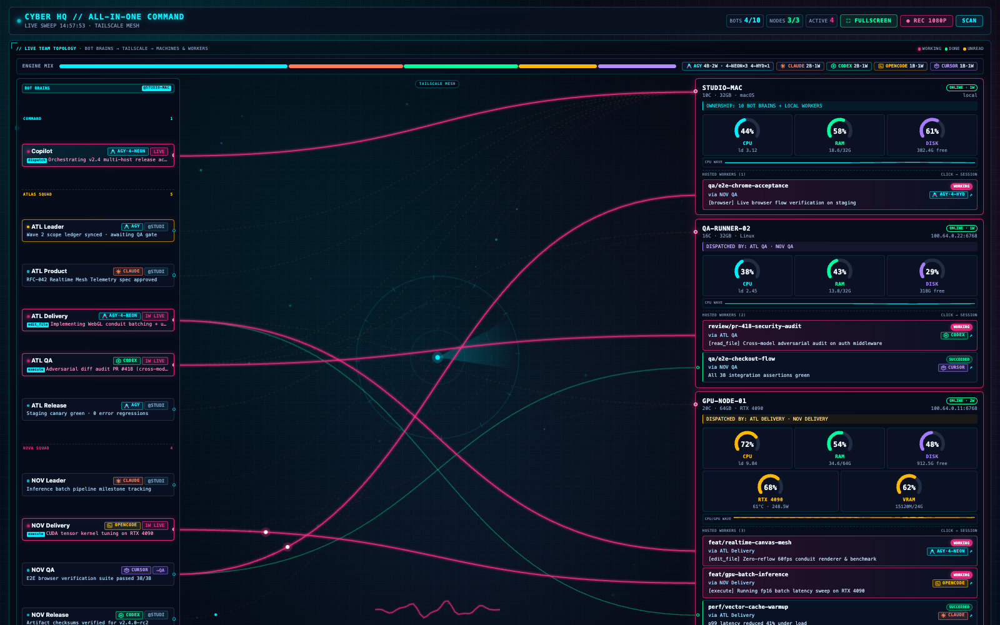
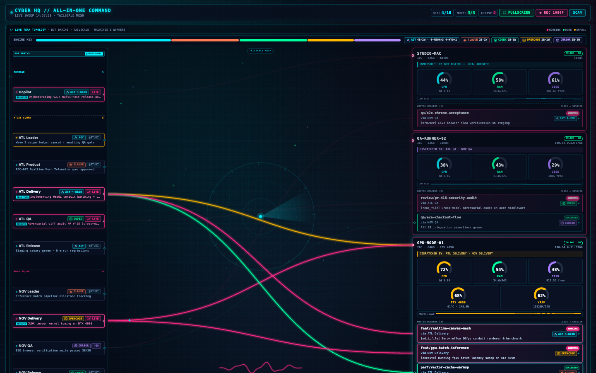

# Cyber HQ Radar

> **A Cyberpunk All-in-One Fleet Command Dashboard for [Orca](https://github.com/stablyai/orca)**  
> *Built with deep respect and admiration for the Orca team and community — making multi-agent orchestration, distributed compute, and autonomous Bot fleets transparent at a single glance.*

[](./LICENSE)
[](https://github.com/stablyai/orca)



<details>
<summary>Interactive Spotlight Mode (Click any Compute Machine to Isolate Its Bot-to-Worker Conduits)</summary>



</details>

---

## Tribute to Orca

**Cyber HQ Radar** is an open-source community tribute to **[Orca (`stablyai/orca`)](https://github.com/stablyai/orca)**.

Orca redefined what an AI-native multi-agent IDE can be: turning isolated terminals into orchestrated Bot teams, paired cross-machine runtimes, and extensible plugin workspaces. This project was born out of running a real multi-machine Orca fleet every day and wanting a mission-control glass cockpit that brings Orca's hidden symphony—Bot brains, cross-host worker dispatches, mixed AI engines, and real hardware load—vividly to life.

Huge thanks to the **Orca** builders for shipping such a clean, hackable plugin architecture (`trusted-worker`, HTML panels, live host events, and paired environments).

---

## Features

- **All-in-One 3-Layer Live Topology**
  - **Left Bay (Bot Brains)**: Every Orca Bot automatically grouped by squad (`COMMAND` + discovered squads), showing live status (`LIVE` / `UNREAD` / `READY`), active tool & task summary, and color-coded engine/model badges with custom inline SVG icons (`AGY`, `CODEX`, `OPENCODE`, `CLAUDE`, `CURSOR`).
  - **Center Arena (Mesh Radar & Fiber Conduits)**: Zero-reflow 60fps holographic radar with real-time animated Bezier conduits, neon comet packets, arrival shockwaves, and live oscilloscope heartbeat linking each Bot straight to its active Workers across paired servers.
  - **Right Bay (Compute Pods + Live Telemetry Gauges + Hosted Workers)**: Live SVG arc gauges (`CPU`, `RAM`, `DISK`, plus NVIDIA `GPU` / `VRAM` / Temp / Power via `nvidia-smi`), rolling `CPU/GPU WAVE` sparklines, and every Worker physically nested inside the machine executing it.
- **Engine Mix Chart**: Real-time segmented distribution bar & icon counters across all Bots and Workers (with exact sub-model tags like `AGY·4-NEON`).
- **One-Click Jump to Orca Session**: Click any Bot or Worker (local or remote paired server) to jump directly into its Orca workspace/session; click blank space or press `ESC` to clear focus.
- **Fullscreen Wallboard (`⛶ FULLSCREEN`)**: Launches a dedicated loopback-only (`127.0.0.1` + random 128-bit per-session token) live SSE command wall scaled to `100vw × 100vh` for secondary monitors or TVs.
- **One-Click 1080p Showcase Video Export (`● REC 1080P`)**: Records an 8-second `1920×1080 @ 30fps` cinema capture of your real live fleet directly to `~/Downloads`.
- **Remote Console Mode (Zero Overhead on Your Control Host)**: Install Cyber HQ Radar on a separate monitoring laptop (e.g. an M4 MacBook Pro) to watch a remote Mac mini / Linux cluster over paired Orca environments + SSH without adding UI rendering load to your Bot host.

---

## Installation

Install directly from GitHub via the Orca CLI:

```bash
orca plugin install peterhiroshi-hub/cyber-hq-radar
```

Orca will print the exact capability grants (`trusted-worker`, `workspace:read`, `workspace:write`, `agent:read`, `storage:own`, `settings:own`) and an approval fingerprint. After reviewing, re-run with `--approve <fingerprint>`:

```bash
orca plugin install peterhiroshi-hub/cyber-hq-radar --approve <fingerprint>
```

Open the panel in Orca's right sidebar:

```bash
orca plugin open peterhiroshi-hub.cyber-hq-radar --panel cyber-hq-radar
```

---

## Remote Console Mode (Monitoring a Cluster from Another Machine)

To run Cyber HQ Radar on your laptop while keeping your Bot control plane on another machine (for example, a Mac mini + paired Linux servers):

1. Pair your control host (and worker servers) in Orca on your monitoring laptop (`orca environment add ...`).
2. Ensure passwordless SSH (e.g. via Tailscale or `~/.ssh/config`) works from your laptop to the servers you want hardware telemetry for.
3. Open **Orca Settings → Plugins → Cyber HQ Radar** and optionally configure:

| Setting | Default | Description |
| --- | --- | --- |
| `controlEnvironment` | `""` (auto) | Paired Orca environment name hosting your Bots (auto-detected if local Orca has no Bots). |
| `sshTargets` | `""` | Optional comma-separated `envName=user@host` overrides for SSH CPU/RAM/Disk/GPU telemetry and SSH hub relay discovery. |
| `hubRelays` | `""` | Optional Zero-SSH HTTP relay map `envName=http://100.x.y.z:19768#token` for hubs running `scripts/hub-relay.mjs`. |
| `showLocalHost` | `true` | Set `false` on a dedicated monitoring laptop to hide the laptop itself and show only remote cluster machines. |
| `pollIntervalSec` | `10` | Sweep interval in seconds (`5–120`). |

### Zero-SSH Hub Relay Mode (Optional)

If your paired hub machine (e.g. a Mac mini) does not have SSH enabled, run the bundled zero-dependency relay on that hub—no `sudo` or SSH daemon required:

```bash
node scripts/hub-relay.mjs --host <your-tailscale-ip> --port 19768
```

It binds strictly to the interface you pass, requires a timing-safe Bearer token, does zero background polling (on-demand stale-while-revalidate), and prints the ready-to-paste `hubRelays` setting value that surfaces both the hub's own hardware gauges and all of its downstream paired worker servers (including GPU/VRAM) in a single request.

---

## Security & Permissions

- **Why `trusted-worker`**: Needed to invoke the local `orca` CLI for Bot/environment/worker status, collect host CPU/RAM/Disk/GPU metrics locally or via SSH (`BatchMode=yes`), save exported videos to `~/Downloads`, and serve the loopback-only (`127.0.0.1`) Fullscreen Wallboard with a random per-session auth token.
- **No external telemetry**: All data stays strictly on your local machine and your own paired Orca/SSH hosts.

## Development

```bash
orca plugin validate . --json
orca plugin test . --json
orca plugin check . --json
orca plugin dev load . --json
```

## License

MIT © 2026 [peterhiroshi-hub](https://github.com/peterhiroshi-hub)
